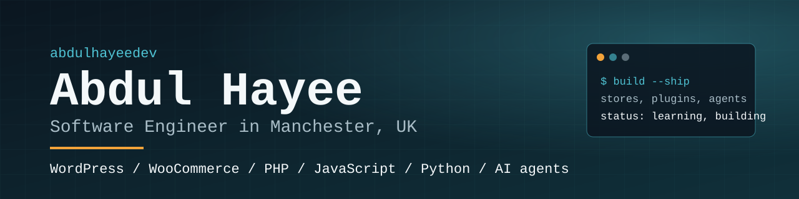

  
  
  

## About

I build online stores, WordPress/WooCommerce plugins and small AI tools. Most of my work is practical: things that run in production and that people actually use.

- Built and maintained a WooCommerce store with **50,000+ products**, including a custom theme and plugins
- Wrote an AI chatbot plugin for WordPress
- Built React / TanStack client sites and POS systems
- Currently learning more about AI agents and RAG

## Tech stack

  
  
  
  
  
  
  
  
  
  
  
  

## Selected work

| Project | What it is |
| --- | --- |
| WooCommerce store | 50,000+ products, custom theme and plugins |
| WordPress AI chatbot | Chatbot plugin that answers customer questions on-site |
| [Rag-based-Chatbot](https://github.com/abdulhayeedev/Rag-based-Chatbot) | Retrieval-augmented chatbot over your own documents |
| Timesheet app | Supabase-backed check-in/out tracker with row-level security |
| POS systems | Point-of-sale tooling for small retail |
| Client sites | React / TanStack front ends |

